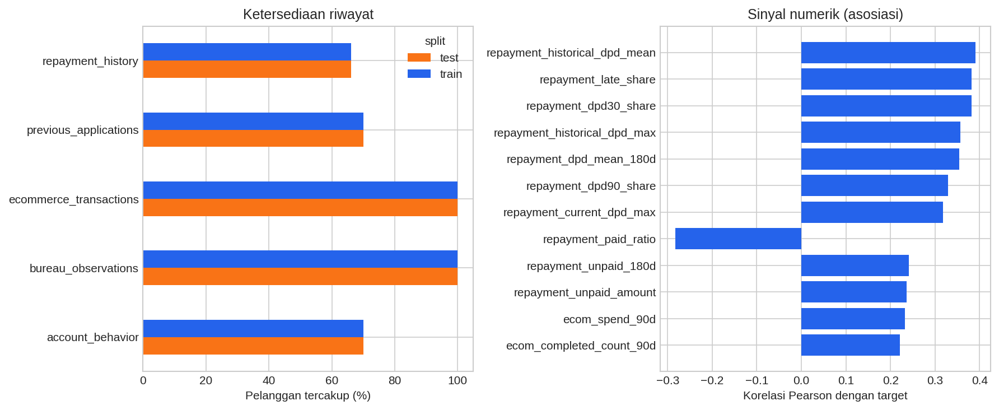
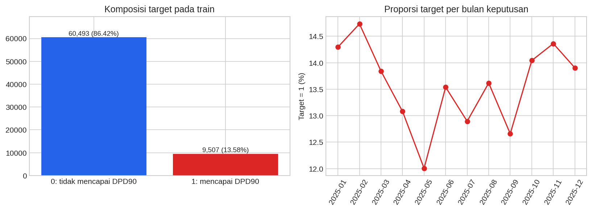
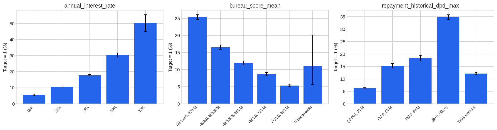
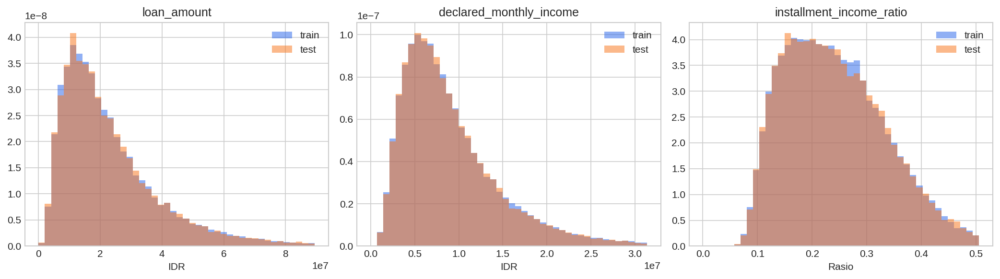
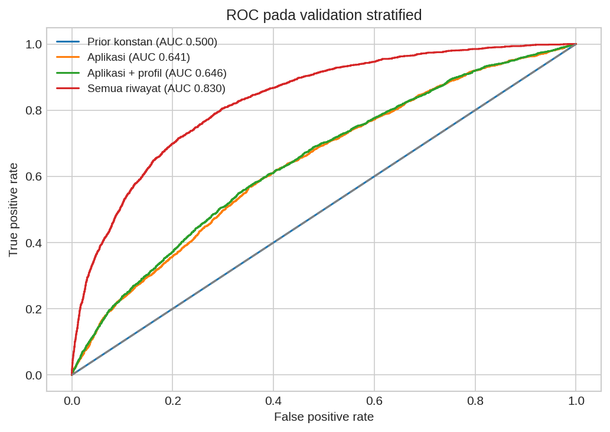
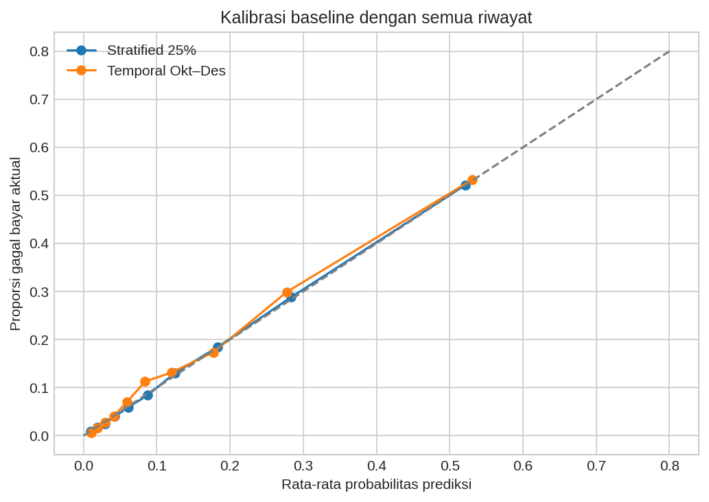

# Analisis data LOGIKA UI 2026

Sumber: [data kompetisi Kaggle](https://www.kaggle.com/competitions/data-science-competition-logika-ui-2026/data), diunduh melalui API Kaggle dengan kredensial lokal. Analisis mengikuti `DATA_DICTIONARY.md` versi 2. Tanggal berkas di manifest: 10 Oktober 2026. Waktu dalam data memakai Asia/Jakarta dan nominal uang dalam rupiah bulat. Region dan penyedia biro adalah fiktif menurut kamus data.

## Temuan utama

- Train berisi **70,000 aplikasi** dan test **30,000 aplikasi**. Ada tepat satu aplikasi terpilih per pelanggan; pelanggan train dan test tidak tumpang tindih.
- Target 1 berarti DPD mencapai **90 hari dalam 12 bulan kalender**, sebanyak **9,507 atau 13.58%**. Memprediksi semua sebagai 0 saja menghasilkan accuracy **86.42%**, sehingga accuracy tidak cukup untuk menilai model.
- Semua waktu observasi riwayat yang diperiksa mendahului keputusan terpilih; bulan rekening juga sudah lengkap. Aturan waktu tetap diterapkan saat membentuk fitur.
- Data e-commerce berisi **4,359,817 barang dari 2,986,855 pesanan**. Menjumlahkan `order_total` per barang pada pesanan completed membesar-besarkan belanja menjadi **1.740 kali** nilai yang benar.
- `sample_submission.csv` dan test mempunyai ID yang sama, **urutan berbeda**. Penyusunan prediksi harus menggunakan join pada `application_id`.

## Struktur dan skala data

| Tabel | Baris | Kolom | Pelanggan | Ukuran MB |
| --- | --- | --- | --- | --- |
| train_applications | 70000 | 10 | 70,000.00 | 8.22 |
| test_applications | 30000 | 9 | 30,000.00 | 3.46 |
| sample_submission | 30000 | 2 | — | 0.78 |
| customer_profiles | 100000 | 8 | 100,000.00 | 6.42 |
| previous_applications | 201984 | 11 | 70,000.00 | 26.69 |
| repayment_history | 1361341 | 9 | 66,157.00 | 159.69 |
| account_behavior | 1084418 | 10 | 70,000.00 | 99.96 |
| bureau_observations | 797563 | 14 | 100,000.00 | 114.74 |
| ecommerce_transactions | 4359817 | 10 | 100,000.00 | 528.85 |

Tabel inti adalah train/test aplikasi. Profil dihubungkan melalui `customer_id` dengan validasi one-to-one. Lima tabel riwayat diagregasi menjadi satu baris per pelanggan sebelum join; menggabungkan baris mentah sekaligus akan menggandakan baris dan nominal. `previous_applications` juga menghubungkan pinjaman historis melalui `loan_id` ke riwayat cicilan. Biro mempunyai observasi untuk aplikasi terpilih dan historis.

## Kualitas data dan arti nilai kosong

| table | column | missing | missing_pct |
| --- | --- | --- | --- |
| previous_applications | loan_id | 42661 | 21.12 |
| previous_applications | approved_amount | 42661 | 21.12 |
| previous_applications | annual_interest_rate | 42661 | 21.12 |
| previous_applications | scheduled_monthly_installment | 42661 | 21.12 |
| repayment_history | last_payment_datetime | 31714 | 2.33 |
| bureau_observations | score | 43839 | 5.50 |
| bureau_observations | utilization | 471615 | 59.13 |

Kolom inti train/test dan profil tidak mempunyai nilai kosong. Audit menemukan 0 duplikasi baris persis dan 0 duplikasi kunci utama/komposit. Semua pelanggan pada tabel pendukung terdapat pada daftar aplikasi terpilih. Audit rinci ada di `quality_audit.json`, termasuk konsistensi saldo, total pesanan, pasangan loan/customer, rentang skor, dan rumus cicilan.

- `loan_id`, nominal disetujui, bunga dan cicilan historis kosong pada aplikasi rejected/cancelled; ini sesuai struktur keputusan, bukan otomatis kesalahan data.
- Skor biro dapat kosong untuk laporan tanpa skor. `utilization` tidak terdefinisi jika limit tidak positif; jangan mengubah semuanya menjadi nol.
- `last_payment_datetime` kosong ketika belum dibayar. Riwayat yang sama sekali tidak tersedia dipertahankan sebagai NaN dengan indikator ketersediaan, agar berbeda dari nilai nol yang benar-benar teramati.
- Tidak ada penghapusan outlier otomatis. Nilai tinggi dapat merupakan kasus kredit yang sah; statistik persentil tersedia di `numeric_summary.csv`.

| table | test | train |
| --- | --- | --- |
| account_behavior | 70.00 | 70.00 |
| bureau_observations | 100.00 | 100.00 |
| ecommerce_transactions | 100.00 | 100.00 |
| previous_applications | 70.00 | 70.00 |
| repayment_history | 66.15 | 66.16 |



## Distribusi dan hubungan dengan target

Median pinjaman pada train **Rp19,000,000**; median pendapatan bulanan **Rp7,784,706**. Median cicilan/pendapatan deklarasi adalah **23.38%**, dengan persentil 95 sebesar **41.80%**. Semua tenor aplikasi terpilih adalah 12 bulan, sehingga `term_months` tidak memberikan variasi prediktif.

Proporsi target per bulan keputusan berkisar **12.01% (2025-05)** sampai **14.73% (2025-02)**. Train dan test mencakup Januari–Desember 2025 pada waktu keputusan.



| Bunga tahunan | Jumlah | Proporsi default | CI95 bawah | CI95 atas |
| --- | --- | --- | --- | --- |
| 16% | 12560 | 0.0549 | 0.0511 | 0.0591 |
| 20% | 29800 | 0.1065 | 0.1030 | 0.1100 |
| 24% | 22358 | 0.1777 | 0.1727 | 0.1827 |
| 28% | 4938 | 0.3036 | 0.2909 | 0.3165 |
| 32% | 344 | 0.5029 | 0.4503 | 0.5554 |

Bunga lebih tinggi berasosiasi dengan proporsi default lebih tinggi. Hal ini dapat mencerminkan penetapan harga berdasarkan risiko yang sudah diketahui; tabel ini tidak membuktikan bunga menyebabkan default. Kelompok bunga 32% kecil, sehingga estimasinya lebih tidak pasti. Error bar menunjukkan interval Wilson 95%, dan seluruh analisis kelompok memakai label train saja.

Temuan yang lebih langsung dari riwayat:

- Rata-rata skor biro pada kelompok ≤626.0 mempunyai proporsi default **25.36%** (14,108 aplikasi), sedangkan kelompok >711.0 **5.32%** (13,889 aplikasi).
- Di antara pelanggan dengan riwayat cicilan, keterlambatan historis maksimum ≤30 hari berasosiasi dengan default **6.26%** (26,156 aplikasi), sementara maksimum ≥90 hari **34.82%** (9,148 aplikasi).
- Pada kelompok cicilan/pendapatan deklarasi terendah, proporsi default **11.09%**; pada kelompok tertinggi **16.59%**. Batas kelompok kuantil tersedia pada tabel lengkap.
- Pelanggan tanpa riwayat aplikasi sebelumnya mempunyai proporsi default **11.72%**, dibandingkan **14.38%** pada yang memiliki riwayat. Perbedaan populasi ini menunjukkan bahwa ketiadaan riwayat perlu dipertahankan sebagai indikator.

Angka di atas adalah asosiasi pada dataset kompetisi ini. Kelompok kuantil dibentuk pada train dan hasil yang ditampilkan dibulatkan.



| feature | pearson_target_correlation |
| --- | --- |
| repayment_historical_dpd_mean | 0.3912 |
| repayment_late_share | 0.3820 |
| repayment_dpd30_share | 0.3820 |
| repayment_historical_dpd_max | 0.3567 |
| repayment_dpd_mean_180d | 0.3544 |
| repayment_dpd90_share | 0.3291 |
| repayment_current_dpd_max | 0.3176 |
| repayment_paid_ratio | -0.2829 |
| repayment_unpaid_180d | 0.2408 |
| repayment_unpaid_amount | 0.2365 |
| ecom_spend_90d | 0.2322 |
| ecom_completed_count_90d | 0.2217 |

Korelasi ini bersifat univariat dan menggunakan observasi yang tersedia. Fitur dengan tingkat kehilangan berbeda mempunyai populasi pembanding berbeda; korelasi, asosiasi kelompok, dan importance model tidak menyatakan sebab akibat. Tabel `default_by_group.csv` memuat jumlah, proporsi target, serta interval kepercayaan untuk kategori dan kelompok kuantil.

## Perbandingan train dan test



Gambar distribusi dibatasi hingga persentil 99 agar terbaca; tabel statistik tetap menggunakan seluruh data. Statistik KS terbesar adalah **0.0144**, dan perbedaan rata-rata terstandar absolut terbesar **0.0273**. Ini menunjukkan perbedaan marginal yang kecil pada fitur yang diperiksa; tidak menjamin distribusi gabungan atau hubungan fitur-target sama. Target test tidak tersedia, sehingga proporsi default test tidak dapat diverifikasi.

| feature | ks_statistic | standardized_mean_difference | train_missing_pct | test_missing_pct |
| --- | --- | --- | --- | --- |
| bureau_Bureau_A_utilization | 0.0144 | -0.0235 | 56.9229 | 57.0100 |
| bureau_Bureau_B_utilization | 0.0140 | -0.0273 | 61.2629 | 61.5467 |
| account_last_closing_balance | 0.0118 | -0.0052 | 30.0000 | 30.0000 |
| account_average_balance_mean | 0.0110 | -0.0046 | 30.0000 | 30.0000 |
| bureau_inquiries_max | 0.0109 | -0.0260 | 0.0000 | 0.0000 |
| account_last_average_balance | 0.0108 | -0.0056 | 30.0000 | 30.0000 |
| bureau_utilization_max | 0.0107 | -0.0239 | 51.9886 | 52.0667 |
| employment_tenure_months | 0.0099 | 0.0192 | 0.0000 | 0.0000 |

## Pembentukan fitur tanpa kebocoran waktu

Cutoff adalah `decision_datetime` aplikasi terpilih, mengikuti definisi profil pada keputusan dan snapshot riwayat sebelum cutoff. Untuk prediksi pada saat pengajuan, seluruh cutoff dan fitur yang baru tersedia saat keputusan perlu ditinjau ulang.

1. Aplikasi historis hanya digunakan jika keputusan historis mendahului cutoff.
2. Cicilan jatuh tempo sebelum cutoff digunakan; pembayaran dan DPD adalah snapshot sebelum cutoff menurut kamus data. Waktu pembayaran yang tersedia diverifikasi mendahului cutoff.
3. Rekening memakai bulan kalender yang sudah selesai; fitur terbaru dan rata-rata tiga bulan lengkap dibentuk terpisah.
4. Biro difilter pada **report_datetime dan available_datetime sebelum cutoff**. Diambil laporan bertanggal paling baru per pelanggan/provider dari seluruh aplikasi yang tersedia, dengan waktu ketersediaan sebagai tie-break. Saldo antarprovider dirangkum lewat max/mean; tidak diasumsikan mewakili utang unik untuk dijumlahkan.
5. E-commerce difilter sebelum cutoff, dideduplicasi per order, dan hanya completed dihitung sebagai belanja. Cancelled menjadi fitur tingkat pembatalan; belanja kategori berasal dari `item_total`.

Fitur mencakup rasio cicilan terhadap pendapatan, pendapatan rekening versus deklarasi, saldo versus cicilan, variasi pendapatan, riwayat keterlambatan, skor/utilization biro, jumlah dan recency aplikasi historis, belanja 90/180 hari, kategori dan metode pembayaran. Hasilnya **116 kolom fitur**, termasuk tenor konstan yang dikeluarkan saat baseline. ID tidak pernah dipakai sebagai angka atau kategori model; tanggal mentah dan split juga dikeluarkan.

## Baseline untuk mengukur informasi prediktif

Metrik resmi leaderboard adalah **Kolmogorov-Smirnov (KS)**, sesuai kutipan Evaluation yang diberikan pengguna. KS adalah perbedaan maksimum antara distribusi skor dua kelas. KS, ROC-AUC, average precision (AP), log loss, dan Brier di bawah dihitung lokal; **bukan skor Kaggle**. KS/ROC-AUC/AP lebih tinggi lebih baik; log loss/Brier lebih rendah lebih baik. Hasil optimasi khusus KS tersedia pada `artifacts/optimization/`, terpisah dari baseline analisis ini.

| model | validation | train_n | validation_n | ks_statistic | roc_auc | average_precision | log_loss | brier_score |
| --- | --- | --- | --- | --- | --- | --- | --- | --- |
| Prior konstan | Stratified 25% | 52500 | 17500 | 0.0000 | 0.5000 | 0.1358 | 0.3973 | 0.1174 |
| Aplikasi | Stratified 25% | 52500 | 17500 | 0.2167 | 0.6411 | 0.2178 | 0.3823 | 0.1137 |
| Aplikasi + profil | Stratified 25% | 52500 | 17500 | 0.2184 | 0.6460 | 0.2232 | 0.3814 | 0.1134 |
| Semua riwayat | Stratified 25% | 52500 | 17500 | 0.5067 | 0.8302 | 0.4705 | 0.3048 | 0.0921 |
| Prior konstan | Temporal Okt–Des | 52413 | 17587 | 0.0000 | 0.5000 | 0.1410 | 0.4070 | 0.1212 |
| Semua riwayat | Temporal Okt–Des | 52413 | 17587 | 0.4861 | 0.8258 | 0.4702 | 0.3148 | 0.0956 |

Model XGBoost memakai parameter tetap, seed 2026, 300 pohon kedalaman 4. Perbandingan tiga kelompok fitur memakai holdout stratified 25% yang sama. Tidak ada pencarian parameter atau early stopping pada validation. Encoder kategorikal hanya fit pada bagian train; XGBoost menangani NaN numerik. ID dan tanggal mentah dikeluarkan. Pemeriksaan temporal melatih Januari–September dan menilai Oktober–Desember; label harus sudah matang jika skema ini diterapkan pada data operasional.

Pada eksperimen ini, menambahkan profil saja memberi kenaikan ROC-AUC kecil, dari **0.6411 menjadi 0.6460**. Menambahkan seluruh riwayat menaikkannya menjadi **0.8302**, dengan AP **0.4705** dibanding prior AP **0.1358**. ROC-AUC temporal **0.8258** menunjukkan hasil tetap serupa pada periode akhir tahun yang diperiksa. Riwayat memberi tambahan informasi yang jauh lebih besar daripada profil pada baseline ini; ini belum mengisolasi kontribusi masing-masing tabel riwayat.





| feature | gain_importance |
| --- | --- |
| repayment_late_share | 0.1279 |
| repayment_historical_dpd_mean | 0.0789 |
| repayment_dpd30_share | 0.0458 |
| ecom_spend_90d | 0.0446 |
| ecom_last_purchase_recency_days | 0.0347 |
| repayment_paid_ratio | 0.0326 |
| bureau_score_min | 0.0272 |
| bureau_score_mean | 0.0256 |
| repayment_current_dpd_max | 0.0242 |
| bureau_score_max | 0.0240 |

Importance di atas adalah gain pohon pada baseline stratified. Fitur yang berkorelasi dapat saling menggantikan dan membagi gain; importance bukan bukti kausal atau jaminan stabilitas. Hasil holdout merupakan estimasi awal, dan pengambilan keputusan model akhir memerlukan cross-validation yang sesuai metrik resmi. Validasi temporal hanya satu periode.

## Prioritas berikutnya

1. Gunakan KS sesuai Evaluation; verifikasi ketentuan penggunaan fitur dan waktu prediksi pada rules kompetisi yang tepat. Jangan memakai metrik dari kompetisi simulasi dengan slug yang mirip.
2. Gunakan baseline semua riwayat sebagai titik awal. Bandingkan beberapa fold stratified karena train/test mempunyai pelanggan berbeda dan periode yang sama, lalu lakukan pemeriksaan temporal tambahan.
3. Uji ablation masing-masing sumber riwayat dan jendela waktu lebih pendek; tinjau kalibrasi jika metrik membutuhkan probabilitas yang akurat.
4. Simpan prediksi dengan ID, lalu join ke urutan `sample_submission.csv`; validasi 30.000 ID unik, tanpa missing, dan probabilitas dalam [0,1].

## Menjalankan ulang

```bash
python -m pip install -r requirements.txt
python scripts/download_data.py
python scripts/analyze.py
# Untuk memakai agregasi yang sudah tersedia:
python scripts/analyze.py --reuse-features
# Memperbarui laporan dari hasil fitur dan baseline yang sudah ada:
python scripts/analyze.py --report-only
```

`analisis_logika.ipynb` adalah notebook pembaca hasil dan contoh reproduksi. `data/raw/` berisi data asli; `data/processed/application_features.parquet` berisi agregasi; `artifacts/tables/` berisi tabel lengkap; `artifacts/figures/` berisi PNG yang dapat diekspor. Kredensial hanya digunakan oleh skrip unduh, tidak disalin ke notebook atau laporan, dan dikecualikan melalui `.gitignore`. Tidak ada submission yang dikirim ke Kaggle.
