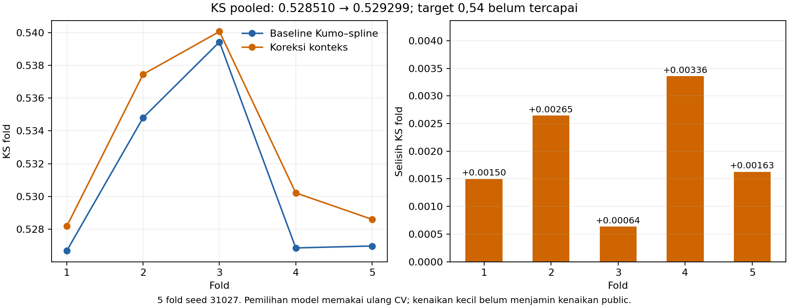

# Riset menuju KS OOF 0,54

Goal dimulai 18 Oktober 2026. Metrik utama adalah KS gabungan seluruh 70.000
prediksi out-of-fold, memakai StratifiedKFold lima fold, shuffle=True, seed 31027.
Rata-rata KS fold, seluruh KS per fold, AUC, dan delta terhadap baseline pada fold
identik juga dilaporkan. Memilih satu fold yang melewati 0,54 tidak memenuhi goal.

Baseline adalah campuran 75% Kumo Large + 25% spline: pooled KS **0,528510**,
rata-rata KS fold **0,530955**. Pengguna melaporkan public **0,56393** untuk
`submission_kumo_spline_exploratory.csv`; file dengan checksum
`3de98287976a7137ad63c946e9932b6ac3ba3a7ee6df607d74cde1aa6a8fc417`
dipertahankan. Lihat [pencatatan public](../kumo_hybrid/public_result_056393.json).

## Jalur awal

- **TabPFN 3.5 / 3.5-Fast:** 8 anggota, 50.000 konteks dari outer-training,
  fitur V5 90 kolom atau fitur denoised yang sudah didokumentasikan. Revisi bobot
  diikat ke commit Hugging Face. Inferensi dan data tetap lokal.
- **Explainable Boosting Machine:** model aditif dengan 12 interaksi yang dipilih
  dari outer-training, 8 bag internal, smoothing dan early stopping internal.
  Varian loss biasa dan seimbang diuji. Bobot seimbang dihitung per outer-training;
  prior populasi dikembalikan sebelum probabilitas dicampur.

Bobot tambahan model baru terhadap baseline ditetapkan 25%, 50%, 75%, serta model
tunggal. Rencana dan parameter disimpan sebelum hasil lengkap tersedia:
[rencana utama](research_plan.json), [EBM](ebm_plan.json).

## Reproduksi

Siapkan fitur V5 dan reverse menggunakan notebook 09/10. Gunakan lingkungan Python
3.11 terpisah dan `requirements-goal054.txt`.

```bash
python scripts/run_research054.py
python scripts/research_ebm054.py
python scripts/research_goal054.py --compare-only
python scripts/research_ebm054.py --compare-only
```

Mode cache TabPFN disimpan di CPU di antara query untuk mengurangi pengulangan
perhitungan konteks. Tidak ada kuantisasi cache. File SafeTensors dimaterialisasi
dengan suffix yang benar karena TabPFN 9.2 mendeteksi format setelah meresolusi
symlink Hub. [Catatan teknis](runtime_adjustment.json) dan preflight mendokumentasikan
perubahan eksekusi. Percobaan awal dihentikan sebelum OOF lengkap dibuat dan tidak
dipakai untuk seleksi.

## Batas interpretasi

Label training, fitur dan lima split ini pernah digunakan pada eksperimen lain.
Pemilihan model berulang mengandung optimisme seleksi; skor ini bukan hasil holdout
yang belum pernah disentuh. Transformasi yang belajar dari label, interaksi,
early stopping, dan model baru dipasang hanya pada outer-training. ID tidak menjadi
fitur, dan label test tidak tersedia. Semua file dengan prediksi berubah mempunyai
skor public yang belum diketahui. Target belum dinyatakan tercapai sampai seluruh
lima fold dan audit selesai.

## Lanjutan 19 Oktober 2026

[Notebook 12](../../../notebooks/12_goal054_research.ipynb) memuat EDA, pembentukan
fitur, baseline, TabPFN, EBM, koreksi konteks/kalender dan Kumo Relational sebagai
kode sel yang dapat direview. Flag training default nonaktif untuk review cache;
aktifkan keluarga yang ingin dihitung ulang. Ekspor otomatis goal baru berjalan
setelah pooled KS mencapai 0,54 dan audit lolos.

TabPFN 3.5/Fast dan kedua EBM telah selesai lima fold. Koreksi kalender memberi
pooled KS terbaik sementara **0,529173**; baseline **0,528510**. Resep kalender
lebih konservatif, `calendar_transfer_l20p0003_unweighted_d0p5`, memberi pooled KS
**0,528812** dan membaik pada kelima fold. Peningkatan kecil dan seleksi berulang
belum membuktikan kenaikan leaderboard. Hasil baru ada dalam
[laporan audit](laporan_riset.md); ini tetap riset berjalan, belum memenuhi goal.

Koreksi konteks memakai 50.000 label konteks dan 6.000 label training yang lain,
seluruhnya di luar validation. Sumber prediksi Kumo yang dihitung ulang berbeda
secara numerik dari cache awal. Identitas fitur/konteks diperiksa persis; hasil
percobaan yang disimpan dipakai tanpa mengulang undian berdasarkan KS. Lihat
[catatan runtime](context_runtime_note.json). Penyebab variasi runtime belum dibuktikan.

Kumo Relational menghubungkan profil dengan empat riwayat sebelum keputusan.
ID hanya penghubung graf. Semua tabel bebas target, pelanggan konteks dan query
terpisah. [Manifest fitur](relational_feature_manifest.json) mencatat cutoff,
sampling, jumlah baris dan hash. [Rencana](relational_plan.json) dikunci sebelum
skor; preflight teknis tidak menghitung KS.

```bash
python scripts/research_context_correction054.py
python scripts/research_calendar054.py
python scripts/build_relational054.py
python scripts/research_relational054.py --preflight
python scripts/research_relational054.py
python scripts/report_goal054.py
python scripts/build_goal054_notebook.py --execute
```

## Kandidat interim setelah audit koreksi

Koreksi Kumo `kumo_offset_l20p003_unweighted_d0p5` menghasilkan pooled KS
**0,529299** (baseline **0,528510**, delta **+0,000789**) dan rata-rata KS fold
**0,532907** (baseline **0,530955**). Seluruh **5/5 fold membaik**. CSV interim:
[submission_goal054_kumo_offset_l20p003_unweighted_d0p5_w1.csv](../../../submission_goal054_kumo_offset_l20p003_unweighted_d0p5_w1.csv).
30.000 ID diurutkan sesuai sample; [metadata dan checksum](submission_metadata.json).
Public belum diketahui dan target 0,54 belum tercapai. Flag `EXPORT_INTERIM_CANDIDATE`
pada notebook menghasilkan file ini; ekspor interim memerlukan kenaikan pooled
serta lima fold membaik. Checkpoint public tetap dipertahankan.

Bootstrap berpasangan untuk resep kalender sebelumnya memberi interval 95% selisih
KS **[-0,001332; +0,002607]**. Itu hanya ketidakpastian kondisional prediksi OOF,
bukan koreksi optimisme seleksi atau variasi retraining; lihat
[hasil dengan nama kandidat eksplisit](paired_uncertainty_calendar_transfer_l20p003_unweighted_d1p0_w1.json).

Agregasi graf awal melebihi batas memori sebelum menghasilkan OOF. Versi readout
menghitung tujuan tabel pelanggan saja pada satu hop, dengan semua sumber dan
pesan masuk dipertahankan. Bobot, fitur, sampling dan konteks tetap sama; nama resep
baru mengikat hash implementasi. Pemeriksaan FP32/FP16, cache dan indeks lolos
[18 perbandingan](relational_readout_parity.json). Perbandingan probabilitas pada
data asli dan evaluasi lima fold berjalan terpisah. Tidak ada skor yang diklaim
untuk percobaan teknis yang gagal. Lisensi asal ada pada `third_party/structured-data-models/`.

Batch inferensi relasional diperbesar menjadi 8.192 untuk mengurangi pengulangan
join CPU dan pemindahan cache. Percobaan batch 1.024 dihentikan sebelum satu pun
skor fold dihitung; konteks, fitur, bobot dan seed tidak berubah. Nama resep baru
mencatat perubahan teknis ini.



Bootstrap kandidat koreksi Kumo terbaru memberi interval 95% delta KS
**[-0,001286; +0,002729]**; [hasil kandidat tersebut](paired_uncertainty_kumo_offset_l20p003_unweighted_d0p5_w1.json).
Kenaikan pada semua fold belum membuktikan kenaikan di data baru.

Kontrol numerik memisahkan dampak sumber Kumo yang dihitung ulang dari dampak
koreksi. Tanpa koreksi, sumber baru memberi pooled KS **0,528487** (delta terhadap
cache awal **-0,0000225**). Koreksi menaikkannya menjadi **0,529299**, delta
**+0,0008120**, dan seluruh fold tetap membaik terhadap kontrol tersebut.
[Lihat kontrol sumber](numerical_source_control.json).

Sesudah lima fold relasional selesai, antrian membentuk tiga gabungan dengan
kandidat koreksi, memakai bobot relasional 25%/50%/75% yang ditetapkan sebelum
skor relasional pertama tersedia. Tidak ada model stacking yang dilatih dari label
OOF. [Rencana](relational_blend_plan.json). Antrian lalu menjalankan audit,
bootstrap, dan eksekusi notebook. Skor yang berubah hanya dinyatakan setelah
seluruh lima fold dan audit selesai.
