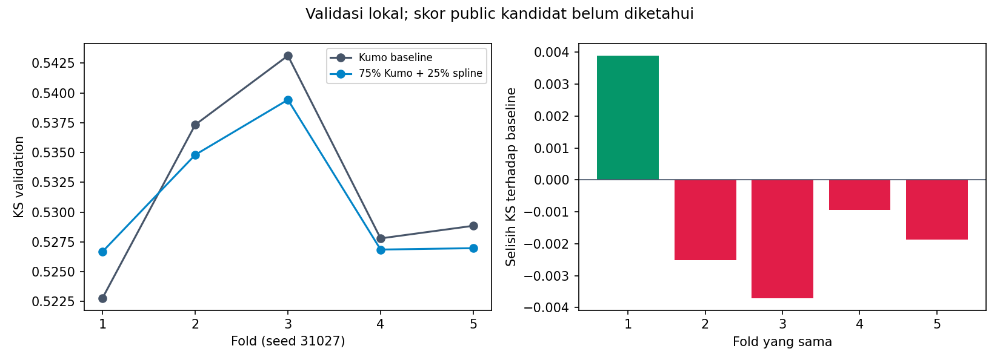

# Kumo dan spline: hasil improvement

Gabungan tetap **75% Kumo Large + 25% spline fitur laten**, belum lolos pemeriksaan lima fold.

| Ukuran pada lima fold identik | Kumo baseline | Gabungan | Selisih |
|---|---:|---:|---:|
| KS pooled OOF | 0.527223 | 0.528510 | +0.001287 |
| Rata-rata KS fold | 0.531984 | 0.530955 | -0.001029 |
| ROC-AUC pooled | 0.847110 | 0.847321 | +0.000211 |

KS membaik pada **1/5 fold**.



## Resep dan seleksi

Kumo Large memakai 90 fitur, 8 anggota, maksimum 50.000 baris konteks, FP16, bobot pretrained v1.0.1 yang dibekukan. Spline memakai resep reverse_spline dari notebook 07: basis kubik 5 knot, C=0,05, tanpa interaksi, tanpa pembobotan kelas.
Imputasi, knot, standardisasi, encoding kategori, dan koefisien spline dipelajari hanya dari outer-training setiap fold. Estimasi fitur laten tidak memakai target, tetapi memakai fitur seluruh train seperti audit sebelumnya.
Prediksi OOF sebelumnya dipakai untuk screening dua keluarga model dengan bobot tambahan 25% dan 50%. Campuran spline 25% diteruskan. Spline tiga fold kemudian dilatih ulang dalam lingkungan Kumo agar pipeline memakai versi paket yang sama.
Bobot 75/25 dikunci sebelum lima fold dihitung. Baseline dan kandidat dibandingkan pada baris dan seed identik. Probabilitas test dirata-ratakan dari lima model per komponen lalu dicampurkan.

### Reproduksi screening tiga fold

| Model | KS pooled | Rata-rata KS fold | Δ pooled | Fold membaik |
|---|---:|---:|---:|---:|
| frozen_baseline | 0.528068 | 0.529071 | +0.000000 | 0/3 |
| spline_only | 0.517505 | 0.519495 | -0.010562 | 0/3 |
| kumo75_spline25 | 0.529144 | 0.530372 | +0.001077 | 2/3 |

## Batas interpretasi

Label training dan lima split ini sudah pernah dipakai untuk eksperimen lain. Hasil merupakan pemeriksaan konsistensi dengan pemilihan model berulang, bukan holdout yang belum pernah disentuh. Kenaikan kecil belum membuktikan signifikansi statistik dan tidak menjamin kenaikan Kaggle.
Skor tiga dan lima fold tidak dibandingkan langsung. Checkpoint public yang sudah dikonfirmasi tetap submission_kumo.csv dengan skor **0,56262**. Public kandidat baru **belum diketahui**.

## Reproduksi dan audit

Gunakan Python 3.11 dan requirements-kumo.txt. Notebook [10_kumo_spline.ipynb](../../../notebooks/10_kumo_spline.ipynb) memuat EDA, seluruh agregasi, kode Kumo/spline, validasi dan ekspor.
```bash
python scripts/hybrid_kumo.py
python scripts/report_hybrid_kumo.py
python scripts/build_hybrid_kumo_notebook.py --execute
```

Jalur CLI memerlukan fitur V5 dan reverse. Notebook membangun fitur dari data mentah jika cache belum tersedia. Bobot Kumo dan data mentah tetap lokal; tidak ada upload otomatis ke Kaggle.
Audit menghitung ulang KS dengan SciPy, memeriksa hash input baseline dan batas fold, serta menghitung ulang prediksi OOF/test spline dari model tersimpan. CSV diperiksa terhadap sample submission dan sumber ensemble.

## Submission kandidat

[`submission_kumo_spline_exploratory.csv`](../../../submission_kumo_spline_exploratory.csv) — 30.000 probabilitas; public score belum diketahui.

SHA-256: `3de98287976a7137ad63c946e9932b6ac3ba3a7ee6df607d74cde1aa6a8fc417`.

File ini **eksploratif**: pooled KS naik, tetapi rata-rata KS turun dan hanya 1/5 fold membaik. File belum memenuhi aturan promosi dan tidak mengganti checkpoint public 0,56262.
