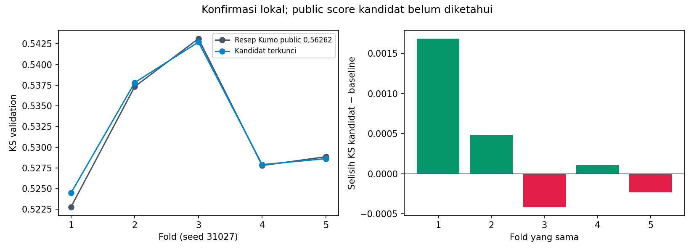

# Improvement Kumo: hasil eksperimen

Kandidat terkunci: `v5_fullcontext_e8`. Konfirmasi **belum lolos**.

Checkpoint Kaggle yang sudah terkonfirmasi tetap `submission_kumo.csv`, public **0,56262**.
Skor public kandidat baru belum diketahui. Tidak ada upload otomatis.

## Perbandingan lima fold identik

| Ukuran | Baseline Kumo | Kandidat | Selisih |
|---|---:|---:|---:|
| KS pooled OOF | 0.527223 | 0.527050 | -0.000173 |
| Rata-rata KS fold | 0.531984 | 0.532310 | +0.000327 |
| ROC-AUC pooled | 0.847110 | 0.847177 | +0.000067 |

KS membaik pada **3 dari 5 fold**.



Baseline memakai 90 fitur, 8 anggota ensemble, dan maksimum 50.000 baris konteks.
Setiap kandidat menggunakan hanya konteks outer-training; semua prediksi validation adalah OOF.
Probabilitas test dirata-ratakan dari lima konteks fold, sesuai bobot yang dikunci.

## Seleksi awal tiga fold

| Kandidat / campuran | KS pooled | Rata-rata KS fold | Δ pooled | Fold membaik |
|---|---:|---:|---:|---:|
| `public_056262_recipe` | 0.528068 | 0.529071 | +0.000000 | 0/3 |
| `core37_e8` | 0.525239 | 0.526628 | -0.002829 | 0/3 |
| `baseline_plus_core37_e8_w0.25` | 0.526857 | 0.528567 | -0.001210 | 0/3 |
| `baseline_plus_core37_e8_w0.5` | 0.526355 | 0.526969 | -0.001712 | 0/3 |
| `denoised_e8` | 0.526194 | 0.527490 | -0.001874 | 1/3 |
| `baseline_plus_denoised_e8_w0.25` | 0.527221 | 0.528550 | -0.000847 | 0/3 |
| `baseline_plus_denoised_e8_w0.5` | 0.527023 | 0.528398 | -0.001045 | 1/3 |
| `tabicl_denoised_e8` | 0.524198 | 0.526455 | -0.003869 | 1/3 |
| `baseline_plus_tabicl_denoised_e8_w0.25` | 0.526697 | 0.528819 | -0.001371 | 1/3 |
| `baseline_plus_tabicl_denoised_e8_w0.5` | 0.526219 | 0.528031 | -0.001848 | 1/3 |
| `tabicl_v5_e8` | 0.521644 | 0.523700 | -0.006423 | 0/3 |
| `baseline_plus_tabicl_v5_e8_w0.25` | 0.527213 | 0.528643 | -0.000854 | 2/3 |
| `baseline_plus_tabicl_v5_e8_w0.5` | 0.526190 | 0.527367 | -0.001877 | 1/3 |
| `v5_balanced1_e8` | 0.526484 | 0.528092 | -0.001584 | 1/3 |
| `baseline_plus_v5_balanced1_e8_w0.25` | 0.528559 | 0.529133 | +0.000492 | 2/3 |
| `baseline_plus_v5_balanced1_e8_w0.5` | 0.527333 | 0.528638 | -0.000735 | 1/3 |
| `v5_balanced2_e8` | 0.527098 | 0.529287 | -0.000970 | 2/3 |
| `baseline_plus_v5_balanced2_e8_w0.25` | 0.527961 | 0.528971 | -0.000107 | 2/3 |
| `baseline_plus_v5_balanced2_e8_w0.5` | 0.527983 | 0.529054 | -0.000084 | 2/3 |
| `v5_e16` | 0.526988 | 0.527573 | -0.001079 | 1/3 |
| `baseline_plus_v5_e16_w0.25` | 0.527917 | 0.528627 | -0.000150 | 1/3 |
| `baseline_plus_v5_e16_w0.5` | 0.527474 | 0.528260 | -0.000594 | 1/3 |
| `v5_latent100_e8` | 0.527733 | 0.529256 | -0.000334 | 2/3 |
| `baseline_plus_v5_latent100_e8_w0.25` | 0.528018 | 0.529154 | -0.000049 | 2/3 |
| `baseline_plus_v5_latent100_e8_w0.5` | 0.527939 | 0.528997 | -0.000128 | 2/3 |

Pada seleksi awal, kandidat dipilih hanya jika pooled KS dan rata-rata KS naik serta minimal dua fold membaik.
Bobot campuran kandidat terhadap baseline dibatasi 25% dan 50%. Resep awal dikunci sebelum konfirmasi lima fold.
Sampling kelas seimbang merupakan tahap cadangan bersyarat jika seluruh kandidat awal gagal; rencana tersimpan sebelum sampling diuji.

## Konfirmasi awal yang tidak lolos

Campuran 75% baseline + 25% konteks seimbang: pooled KS **0.527019** (Δ **-0.000204**), rata-rata KS **0.532273** (Δ **+0.000289**), membaik pada **3/5 fold**.
Campuran tidak diekspor karena pooled KS turun. Sesudah itu, resep konteks penuh ditetapkan sebelum prediksinya dihitung, memakai lima split yang sama.
Konteks penuh memakai 56.000 baris per fold, dibanding batas 50.000 pada baseline. Fitur, delapan anggota ensemble, dan seed tetap sama.
Pada tiga fold awal, training hanya 46.666–46.667 baris sehingga kedua batas konteks menghasilkan input identik. Efek konteks tambahan baru diuji pada lima fold.
Uji lanjutan ini merupakan tambahan pemilihan model pada lima split yang sama; hasilnya dapat optimistis.

## Batas interpretasi dan reproduksi

Pergantian seed menggunakan label training yang sama, sehingga konfirmasi ini bukan holdout yang belum pernah dipakai.
Pencarian berulang mengandung optimisme seleksi. Selisih kecil belum menunjukkan signifikansi statistik atau menjamin kenaikan leaderboard.
Skor tiga dan lima fold tidak dibandingkan langsung karena ukuran training dan pembagian baris berbeda.
Estimasi noise tidak memakai target, tetapi parameter unsupervised memanfaatkan fitur seluruh train seperti audit sebelumnya.
Pemeriksaan ulang fitur dari data mentah cocok dalam toleransi rtol=1e-6 dan atol=1e-7; seed RNG asli belum diketahui.

Gunakan Python 3.11 dan `requirements-kumo.txt`, dengan GPU CUDA. Bobot Kumo v1.0.1 serta TabICLv2 resmi dijalankan lokal.
Notebook [09_kumo_improvement.ipynb](../../../notebooks/09_kumo_improvement.ipynb) memuat EDA, agregasi, semua kode model, perbandingan dan ekspor.

```bash
python scripts/run_kumo_improvement.py
python scripts/verify_kumo_improvement.py
python scripts/report_kumo_improvement.py
python scripts/build_kumo_improvement_notebook.py --execute
```

Jalur CLI memerlukan fitur V5 dan reverse yang dibangun dari notebook sebelumnya. Pipeline otomatis menghitung kandidat yang belum tersedia dan memeriksa cache sebelum memakainya. Untuk menjalankan hanya tahap awal:

```bash
python scripts/improve_kumo.py --candidates core37_e8 denoised_e8 v5_latent100_e8 v5_e16 --test
```

Data mentah, fitur parquet, dan prediksi per baris tidak disertakan di Git. Definisi, metadata fold, metrik, serta checksum disertakan.
Cache diperiksa terhadap data, resep, dan versi paket. Model pralatih tetap membekukan bobot.
