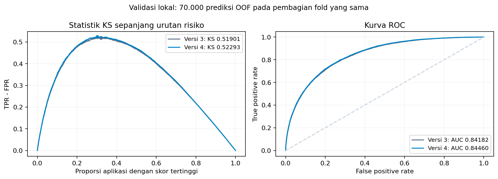

# Submission versi 4 untuk KS

Checkpoint versi 3 memperoleh public KS **0,55845**, terkonfirmasi melalui API Kaggle. Skor public versi 4 belum tersedia. Skrip ini membuat file untuk diunggah sendiri dan tidak mengirim submission otomatis.

Fitur baru merangkum harga yang dinormalisasi menurut kategori, frekuensi keterlambatan pada cicilan yang sudah cukup umur untuk mencapai ambang DPD, serta skor biro yang dirata-ratakan dengan bobot setara antarprovider. Referensi harga dan prior keterlambatan memakai riwayat customer training tanpa label target. Audit memeriksa seluruh waktu observasi sebelum keputusan.

Gabungan akhir memakai resep berikut:

```json
{
  "public_055845": 0.3333333333333333,
  "v4_cat5_balanced_500": 0.3333333333333333,
  "spline": 0.3333333333333333
}
```

| Perbandingan pada baris dan pembagian fold yang sama | Versi 3 | Versi 4 |
|---|---:|---:|
| KS OOF keseluruhan, seleksi tiga fold | 0.51970 | 0.52411 |
| Rata-rata KS, seleksi tiga fold | 0.52285 | 0.52740 |
| KS OOF keseluruhan, tahap sepuluh fold | 0.51901 | 0.52293 |
| Rata-rata KS, tahap sepuluh fold | 0.52352 | 0.52940 |
| ROC-AUC OOF, tahap sepuluh fold | 0.84182 | 0.84460 |



Pada tahap sepuluh fold, KS meningkat pada **9 dari 10 fold**. Tidak ada perbandingan langsung rata-rata statistik maksimum KS antara ukuran fold yang berbeda. Estimasi bootstrap berpasangan tersedia pada metadata; estimasi itu memakai prediksi OOF tetap dan tidak mengoreksi optimisme seleksi.

Model baru memakai 90% label per fold. Komponen versi 3 dipertahankan dari prediksi yang sudah tersimpan, termasuk anggota historisnya yang dilatih pada tiga fold. Fitur, jumlah pohon, dan bobot dipilih menggunakan label training yang sama, sehingga hasil lokal adalah estimasi dengan optimisme seleksi dan tidak menjamin peningkatan leaderboard. Tidak ada label test yang dipakai.

File `submission_v4.csv` berisi 30.000 probabilitas kontinu sesuai header dan urutan sample submission. SHA-256: `890e05a3f0b09500142395d5498e939928328b2770c509ca035f760a8dea8344`. `submission.csv` memuat isi yang sama. Versi 3 serta checkpoint public persisnya dipertahankan.

Reproduksi setelah membangun fitur versi 3:

```bash
python scripts/build_features_v4.py
python scripts/evaluate_v4.py
python scripts/evaluate_spline_v4.py
python scripts/select_v4.py
python scripts/train_v4_candidate.py --candidate v4_cat5_balanced_500
python scripts/train_v4_candidate.py --candidate spline
python scripts/export_v4_submission.py
```
