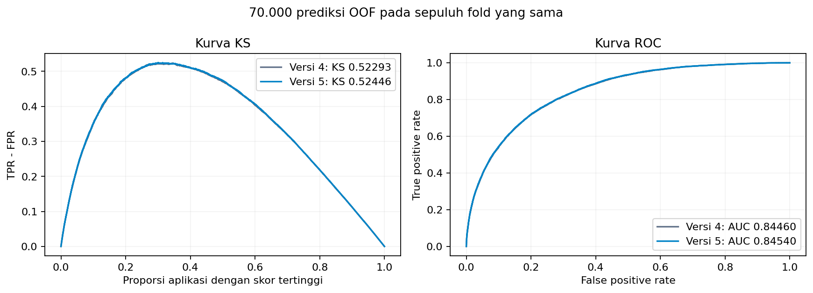

# Kandidat submission versi 5

Versi 5 menggabungkan 75% versi 4 dan 25% TabM. TabM dilatih dari label kompetisi; tidak memakai model pretrained atau data eksternal. Harga per unit dari basket completed dan cancelled dipakai sebagai sinyal pilihan produk. Nilai cancelled tidak dihitung sebagai belanja. Waktu seluruh transaksi diperiksa sebelum keputusan.

| Validasi pada baris dan fold yang sama | Versi 4 | Versi 5 |
|---|---:|---:|
| KS OOF, tiga fold | 0.524109 | 0.525285 |
| Rata-rata KS, tiga fold | 0.527404 | 0.527524 |
| KS OOF, sepuluh fold | 0.522934 | 0.524464 |
| Rata-rata KS, sepuluh fold | 0.529401 | 0.530121 |
| ROC-AUC, sepuluh fold | 0.844598 | 0.845405 |
| Log loss, sepuluh fold | 0.294741 | 0.294015 |

KS meningkat pada **5 dari 10 fold**. Pemilihan kandidat tiga fold hanya meningkatkan satu fold dan tidak memenuhi aturan seleksi ketat pada `select_v5.py`; kandidat ini diteruskan sebagai konfirmasi eksploratif karena KS gabungan dan rata-ratanya meningkat sedikit. Bobot 25% dikunci sebelum pelatihan sepuluh fold. Aturan promosi akhir: KS gabungan dan rata-rata fold harus meningkat, dengan minimal enam fold membaik. Kandidat ini meningkatkan kedua statistik agregat, tetapi **belum memenuhi syarat enam fold**. Tidak ada perubahan bobot dari hasil sepuluh fold. File kandidat tetap disediakan untuk review dan pengujian public leaderboard.



Early stopping TabM memakai split stratified 12,5% **di dalam training setiap outer fold**, berdasarkan weighted log loss. Setelah jumlah epoch dipilih, encoder dan model dilatih ulang pada seluruh training outer fold. Median, skala, kategori, dan bin embedding dipelajari pada training terkait. Label outer validation tidak dipakai untuk early stopping. TabM memiliki 16 anggota yang dilatih dengan loss masing-masing, lalu probabilitasnya dirata-ratakan. Transformasi bobot kelas dilakukan per anggota jika bobot positif lebih dari satu.

Eksperimen yang belum dipromosikan meliputi spline dengan fitur tambahan/interaksi/regularisasi berbeda, Explainable Boosting Machine, XGBoost dangkal, CatBoost dangkal, specialist menurut ketersediaan riwayat pembayaran, dan TabM dengan fitur inti. Definisi dan ringkasan seluruh kelompok tersedia dalam folder ini; `blend_ranking.json` menunjukkan hasil pencarian. Pencarian menggunakan label train yang sama sehingga hasil lokal mengandung optimisme seleksi. Bootstrap pada metadata hanya memakai prediksi OOF tetap dan tidak mengoreksi proses seleksi. Tidak ada label test yang digunakan.

Skor public versi 5 **0,55680**, dilaporkan pengguna pada **2026-10-15**. Selisih terhadap versi 3 (0,55845) adalah **−0,00165**. Hasil ini belum diverifikasi ulang melalui API Kaggle. Peningkatan OOF belum diikuti peningkatan public leaderboard. Skor public terbaik yang tercatat tetap versi 3: **0,55845**. File dibuat untuk diunggah oleh pengguna; tidak ada submit otomatis. `submission_v5.csv` berisi kandidat versi 5; `submission.csv` tetap versi 4 karena syarat promosi belum terpenuhi. Versi 4 dan checkpoint versi 3 tetap tersedia.

SHA-256: `2b97dcdc26f38cabc6ab1a3f3053903975b488a5480df8ff739415a7bc750526`.

```bash
python -m pip install -r requirements-v5.txt
python scripts/build_features_v5.py
python scripts/evaluate_v5.py --group tabm
python scripts/train_v5_candidate.py --candidate v5_tabm_weight1 --new-weight .25
python scripts/export_v5_submission.py
```

Fitur/model versi 4 harus tersedia terlebih dahulu, atau jalankan notebook 06 yang membangun seluruh komponennya. Lingkungan referensi memakai Python 3.10, PyTorch 1.13.1+cu116, dan GPU A100. CPU didukung; durasi dan pembulatan dapat berbeda pada lingkungan lain.
