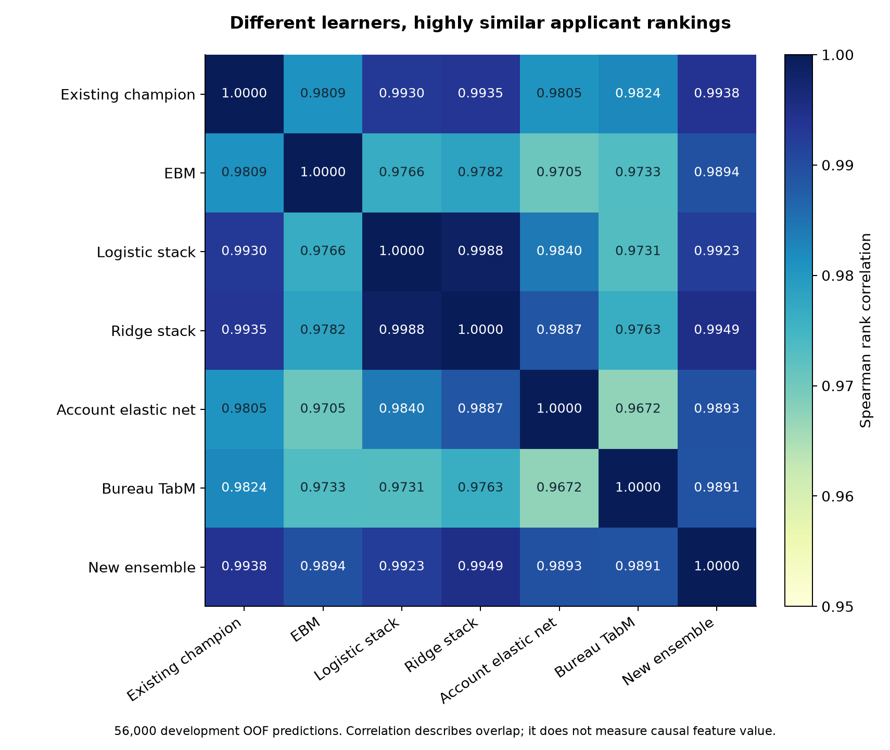
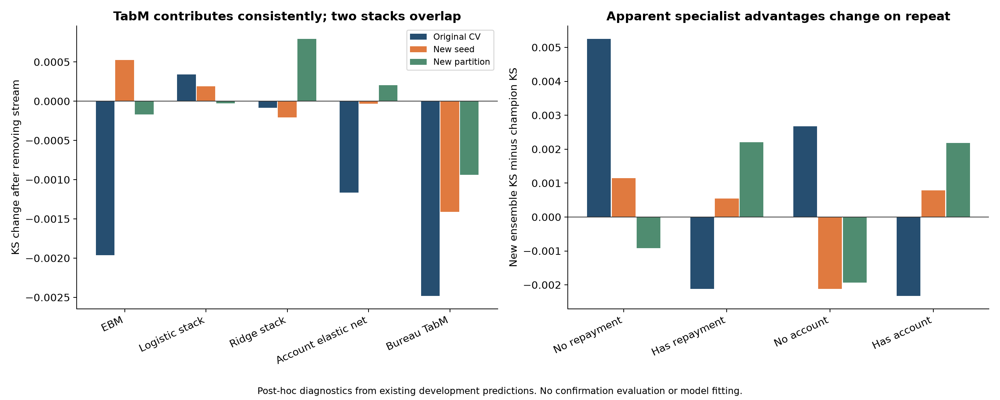

# What the existing experiments actually establish

Analysis date: 18 October 2026, Asia/Jakarta. This audit uses the saved experiment evidence and development predictions. **No new model was fitted, no competition-test predictions were generated, and confirmation was not reopened for the new diagnostic combinations.**

The strongest explanation for diminishing returns is repeated information and highly correlated predictions, compounded by noisy selection and several numerically weak implementations. The evidence does **not** establish a hard ceiling for this dataset. The new pipeline changes the learner portfolio substantially while changing applicant rankings very little.

## 1. Evidence and scope

- Latest campaign: 2,673 completed run records, including controls and repeated validation; 2,620 distinct non-nested screened configurations, 12 nested configurations, and 4,096 fixed prediction blends. The node380 aggregation omission was reconciled separately.
- Main development population: 56,000 applications, including 7,606 defaults. Comparisons use saved complete OOF predictions from the original CV, a new training seed, and a second CV partition.
- Historical context: Logika v5 specialist and smoothing summaries, and the preceding champion's unsuccessful seed-averaging pass. Their scores are compared within their own protocols, not directly ranked against current CV.
- New computations are descriptive statistics, fixed algebraic replays, saved-transform diagnostics, and plots. Newly inspected ablations/routing rules are **post-hoc research findings**, not newly confirmed nominees. They do not increase the campaign's training count.

## 2. Different architecture, mostly the same risk signal

| Diagnostic | Observed value |
|---|---:|
| New ensemble versus champion rank correlation | 0.993812 |
| Mean pairwise rank correlation among old five components | 0.959960 |
| Mean pairwise rank correlation among new five streams | 0.978687 |
| Correlation between the two new nested stacks | 0.998794 |

Both pipelines use the same application and history foundation. Each nested stream reuses the champion's income-gap logistic recipe and LightGBM/SVD recipe, together with a repayment elastic-net recipe. The new streams are therefore not five independent sources of information.

At a fixed top-20% risk-review capacity, the new ensemble finds 113 defaults outside the champion's selected set but loses 106 that the champion selected: **seven additional defaults net**. This is an illustrative operating point, not the competition objective or a recommended lending policy. The two top-risk sets have Jaccard overlap 0.9165.

The new probability scale is closer to the observed default rate: mean prediction 0.134669 versus 0.123738 for the champion, against an observed rate of 0.135821. Brier score improves from 0.090234 to 0.090050; log loss improves from 0.298006 to 0.297913. Ranking and calibration are different properties: a global monotone recalibration alone cannot improve rank-based KS.



## 3. What worked

### Learner diversity: TabM has the clearest marginal contribution

The following changes remove one stream and renormalize the remaining logit weights. They describe conditional contributions to this particular portfolio, not causal feature importance or Shapley values.

| Removed stream | Original-CV KS change | New-seed change | New-partition change |
|---|---:|---:|---:|
| EBM | -0.001965 | +0.000526 | -0.000167 |
| Logistic stack | +0.000342 | +0.000190 | -0.000027 |
| Ridge stack | -0.000083 | -0.000206 | +0.000796 |
| Account elastic net | -0.001163 | -0.000033 | +0.000206 |
| **Bureau TabM** | **-0.002482** | **-0.001412** | **-0.000937** |

TabM is the only tested stream whose removal hurts all three aggregate evaluations. EBM is the best individual learner at KS 0.520043, and helps the portfolio in two of three evaluations. The account elastic net supplies a smaller, less consistent contribution.

This favors preserving EBM, TabM and a regularized linear view. It does not support replacing every earlier model merely because a different family wins a standalone leaderboard.

### Appended reductions can help particular learners

The `representation_00` treatment standardizes the existing representation and appends 16 PCA components; it adds no new source-history block. Its nominal 30-day window does not remove longer-term v3 inputs in this representation family.

| Same-host matched learner | KS change versus its v3 anchor | Fold differences |
|---|---:|---|
| XGBoost | +0.004305 | +0.001003, +0.004239, +0.003949 |
| LightGBM | +0.002081 | +0.000203, +0.005281, +0.001280 |
| Elastic-net logistic | -0.000229 | -0.000051, -0.000838, -0.000079 |
| GRU history model | -0.003643 | -0.001747, -0.005807, -0.001917 |

Thus **standardization plus appended PCA helps these boosting probes**, not every learner. Appending useful projections preserves the original feature information; replacing a feature set with a reduction is a different hypothesis. The winning EBM uses a different treatment: selected features plus appended PCA grouped by source.

### A small number of additional history features survive selection

- The winning EBM selected **zero `new_` columns in all three outer folds**. Its gain comes from the treatment of existing information and the learner, not demonstrated value from the 214-column addition.
- The account elastic net retains eleven added columns in each fold: persistent deficits, cash-flow volatility, recent changes, and balance recovery.
- The winning TabM retains only one or two added bureau columns per fold: matched-month provider disagreement, score changes, or score/report-age interactions. Selection differs across folds.

These are useful directions to isolate. Retention by a selector does not prove an independent contribution to KS.

## 4. What did not work, and what remains unresolved

| Approach | Evidence | Interpretation |
|---|---|---|
| More fixed blends | Only 3 of 4,096 beat the champion; all use the same five components | Blend count greatly exceeds independent discoveries |
| Rank blends | 0 of 160 beat the champion | No evidence to prioritize this tested family |
| New trimmed blends | 0 of 864 beat the champion | Old champion's successful trim does not transfer automatically to a new component set |
| Old champion seed averaging | Historical three-seed average KS 0.524353 versus 0.525771 | Seed repeats exposed variance; averaging did not improve that recipe |
| Random Fourier features / ExtraTrees | Best KS 0.501558 / 0.500576 | Weak tested candidates; no present promotion case |
| Local FT/residual/history models | Best FT 0.513709, residual MLP 0.514013, GRU 0.516380, DeepSets 0.516140 | Tested implementations trail the selected portfolio; not proof against every sequence or transformer architecture |
| Foundation models | One completed Kumo configuration: 0.516923; 39 TabICLv2 configurations: best 0.515889 | Unequal coverage; most TabICL results missed the central blend search, so ensemble value is incompletely explored |
| Historical hard specialists | Best specialist CatBoost 0.519551 versus v4 0.524109 on that historical protocol | Splitting training by repayment availability was already tried and lost; a new MoE needs a more specific hypothesis |

### Some actuarial results are implementation diagnostics, not fair negative verdicts

Among 189 WOE scorecard runs, **102** have at least one fold with KS below 0.1. Among 216 credibility-scorecard runs, **204** do. A controller can mark a recipe complete because predictions exist and are finite even when a model is numerically degraded.

A saved failing credibility model has a median absolute standardized credibility value of **52.23** on outer-validation covariates; 78.1% of those values exceed eight standard deviations. In the inspected 2,000-row sample, every raw prediction is below 1e-6. Its scaler has a minimum scale of 4.56e-9.

The code fits the scaler on **inner-cross-fitted bin maps**, then predicts through **full-training bin maps**. Count-dependent uncertainty and credibility features change their exposure scale between those stages. Near-constant training features amplify this mismatch. The sampled failing WOE control also shows a near-zero scaler scale and saturated predictions. These are observed failure signatures; a correction-and-rerun would be needed to quantify their causal impact.

The explicit GLMs have another quality issue: **287 of 1,218 inspected fold optimizations** report unsuccessful convergence. That flag does not automatically invalidate every score, but it prevents treating all completed runs as equally healthy evidence.

The best logit and complementary-log-log GLMs still reach 0.516360 and 0.516274. EBM reaches 0.520043. Actuarial-style probability models therefore remain viable; the credibility implementation's 0.352273 best result is not a convincing rejection of the broader approach. The target supports default probability, not invented LGD, realized-loss severity or survival labels.

The spline probe is also restricted: it uses only the first 64 processed columns. Appended components beyond that position never reach its spline transform. Its weak results do not test unrestricted spline fusion.

## 5. Feature redundancy and attribution limits

The 214 added features were compared with the original **candidate feature bank**, not just with the columns selected by the champion.

| Added family | Added columns | Numerically duplicate bank columns | Total with absolute rank correlation at least 0.95 |
|---|---:|---:|---:|
| Repayment | 80 | 45 | 64 |
| Account | 50 | 21 | 37 |
| Shopping | 55 | 45 | 45 |
| Bureau | 25 | 2 | 8 |
| Cross-source | 4 | 1 | 2 |
| **Total** | **214** | **114** | **156** |

Correlations use 4,000 development rows with median imputation for this descriptive calculation. The 114 numerical matches were checked over all 56,000 development rows with float32-scale tolerances. They are not necessarily 114 columns already fed to the champion. Eighteen added columns are constant in the correlation sample. Only forty are both nonconstant in that sample and below the 0.95 redundancy threshold; low correlation alone does not imply predictive usefulness.

Examples already present in the candidate bank include repayment decay rates, mature-event counts, deficit persistence, cancelled-basket values, and category-relative prices. Making more windows of these quantities often adds another measurement of the same borrower state.

Less redundant candidates include matched-time bureau disagreement and score changes, shopping intervals/payment entropy, delinquency transitions/deterioration, and balance recovery. Their incremental value remains a feature-block question, not a reason to restart a broad model grid.

The campaign's 114 reported feature contrasts change two to four configuration fields; 60 are on the same host. In particular, the impressive bureau-view elastic-net difference of **+0.007238** simultaneously adds the bureau block **and** enables true-gain selection of 128 features. The repayment and shopping contrasts similarly change selection. These establish gains for recipe bundles, not bureau-only or shopping-only causal effects.

Some representation contrasts, such as appended PCA above, can be interpreted more narrowly by auditing executed behavior: the changed window/family labels add no history columns there. Configuration names must not be treated as evidence of an executed temporal treatment.

## 6. Fusion, simplification and mixture of experts

### Ordinary old/new fusion does not solve the problem

Three fixed new-pipeline weights, 0.10/0.25/0.50, were replayed with both probability and logit blending. None improves over the complete new ensemble on original CV. A 50/50 logit blend's mean matched improvement across the three evaluations is +0.000918 versus +0.001276 for the full new ensemble. Preserving the old model by indiscriminately averaging it back in is not supported by these replays.

### Simplification is more defensible than adding more heads

The two nested heads consume **bit-identical inner base OOF matrices** in every inspected comparison: three outer folds in each of three development evaluations, nine out of nine. They train the same three base recipes repeatedly, then change only the meta head. Their final predictions correlate 0.998794.

A four-stream diagnostic dropping the logistic stack gives:

| Pipeline | Original CV | New seed | New partition |
|---|---:|---:|---:|
| Frozen five-stream logit ensemble | 0.526020 | 0.523426 | 0.520846 |
| EBM + ridge stack + account elastic net + TabM | 0.526362 | 0.523616 | 0.520819 |

The simpler version is better on two evaluations and essentially tied on the third. It is **post-hoc and unconfirmed**, not a new champion. It is a stronger efficiency hypothesis than adding another stack. Even if retaining both heads, their base fits and inner matrices can be shared by a provenance-keyed cache rather than retrained.

### Source-availability MoE is plausible but not yet stable

On original CV, the new ensemble beats the champion for applicants without repayment history by +0.005255 cohort KS, but loses by -0.002124 where repayment history exists. That initially suggests the old pipeline as an established-history expert and the new one as a thin-history expert.

The inference fails to remain stable:

| Cohort | Original-CV new-minus-old KS | New seed | New partition |
|---|---:|---:|---:|
| No repayment history, n=18,914 | +0.005255 | +0.001146 | -0.000923 |
| Has repayment history, n=37,086 | -0.002124 | +0.000540 | +0.002209 |
| No account history, n=16,782 | +0.002674 | -0.002115 | -0.001936 |

A fixed rule choosing the new pipeline when account history is absent scores **0.527300** on original CV, but only **0.522606 / 0.519906** on the other evaluations, below the full new ensemble's **0.523426 / 0.520846**. Soft 75%/25% availability gates also fail to dominate. These are useful falsification tests, not fresh validated wins.

A real MoE learns which cases suit which experts; that distinction goes back to [Jacobs et al., Adaptive Mixtures of Local Experts](https://www.cs.utoronto.ca/~hinton/absps/jjnh91.html). Here, any learned gate must receive genuinely nested training predictions and only decision-time covariates. Ordinary global OOF matrices are insufficient to claim a leakage-free learned router. Availability counts, report age, and uncertainty are reasonable hypotheses, but the current cohort results do not establish a reliable routing policy. Tiny cohorts and month-specific winners should not become lookup gates.

## 7. Why returns diminish

1. **Measurement redundancy:** many new columns repeat already available candidate information, particularly shopping prices and repayment rates.
2. **Prediction redundancy:** the new architecture mostly agrees with the champion, and its two stacks are almost duplicates in ranking behavior.
3. **Variance at the scale of the claimed gains:** fold/seed changes are larger than the original +0.000249 KS improvement. The existing confirmation interval includes zero.
4. **Adaptive selection:** thousands of trials repeatedly optimize the same finite set of labels. Model-selection overfitting can be comparable to differences between algorithms, as discussed by [Cawley and Talbot, 2010](https://www.jmlr.org/beta/papers/v11/cawley10a.html). A single public improvement did not validate every future OOF improvement; historical v5 is a counterexample.
5. **Weak attribution:** the current evidence often changes feature blocks and preprocessing together, so broad sweeps find recipes faster than they explain why recipes work.
6. **Numerical and implementation constraints:** saturated scorecards, GLM convergence flags, and a first-64-column spline restriction absorb runs without fairly testing all underlying hypotheses.
7. **Uneven coverage:** one Kumo configuration is not comparable with 154 EBM or 194 elastic-net records as a search of each family's ceiling. Interrupted, unstarted and unavailable methods are not negative results.

There is no evidence here that the standalone completed recipes are literal reruns of identical models: the conservative execution-signature audit found **no bit-identical full-OOF duplicate groups** among its candidate groups. The redundancy claim concerns features, related predictions, and the two stacks' repeated base computations—not an invented count of duplicate completed experiments.

## 8. Recommended next decisions

Do not restart a thousand-configuration sweep. Keep the existing champion frozen and retain the full new ensemble as the strongest predeclared candidate. If more training is later authorized, concentrate on a few falsifiable comparisons:

1. **Fix quality gates before drawing more family conclusions.** Check encoder train/predict exposure consistency, variance floors, saturation and optimizer convergence. Re-test one repaired scorecard control before spending on a family grid.
2. **Compare the four-stream simplification with the frozen five-stream recipe.** Share identical nested base fits even if keeping both meta heads. This targets cost and reliability as well as score.
3. **Isolate genuinely additional information.** Hold the model, selected-feature budget, encoding, scaling and validation fixed; compare v3-only with one bureau-change/disagreement block, one account-recovery block, and one repayment-transition block. Do not bundle the block change with a new selector.
4. **Keep MoE behind a stability gate.** It needs repeatable expert advantages and nested evaluation. The original-CV 0.527300 router is insufficient evidence to deploy it.

The useful outcome is a smaller, better-understood portfolio: preserve the v3 economic/history foundation, retain TabM's measured complementary contribution and EBM's nonlinear view, test whether one stack is enough, and stop treating every extra window or architecture as new information. None of these post-hoc findings has been used to modify a submission.



## Reproduction and evidence

Scripts in the campaign root: `analyze_existing.py`, `analyze_routing.py`, and `plot_existing_analysis.py`.

On PC2, from `/mnt/home/logika-faris-exploration/exploration-12h-20261017`:

```sh
.venv/bin/python analyze_existing.py --root "$PWD" --output "$PWD/analysis-20261018"
.venv/bin/python analyze_routing.py "$PWD" "$PWD/analysis-20261018"
.venv/bin/python plot_existing_analysis.py "$PWD/analysis-20261018"
```

The source scripts read no confirmation labels or prediction arrays. All tables have supporting JSON/CSV alongside this report, including `diversity.json`, `families.json`, `feature_contrasts_audited.json`, `feature_redundancy.json`, `fusion_and_ablation.json`, `fixed_routing_diagnostics.json`, `cohort_stability.json`, `scorecard_diagnostics.json`, `optimizer_status.json`, `finalist_feature_lineage.json`, and `nested_reuse_audit.json`.
